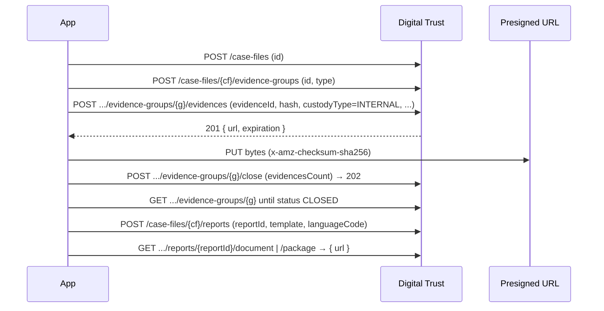
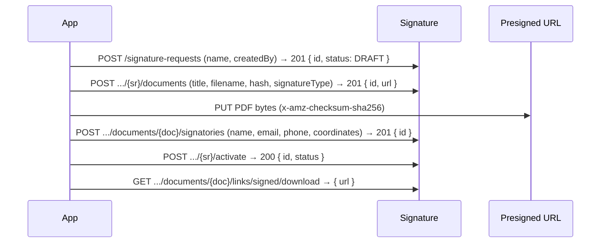

# EAD Factory — API Integration Guide

EAD Factory is **not** one API but a platform of **four independent managers**, each with its own OpenAPI 3.0.1 contract and its own operation set. They share authentication, URL conventions and a few cross-manager links (a chat or a notification can point at Digital Trust evidence and reports), but you integrate against each manager separately.

Every manager is reached at `{host}/{manager-prefix}`, then `/api/v1/private/...`. The host is environment- and tenant-specific (a production host and an `int` integration host exist, e.g. `https://api.int.gcloudfactory.com`); the **manager prefix** is stable and is **not** declared in any contract (none has a `servers:` block):

| Manager | Purpose | Path prefix | Contract |
|---|---|---|---|
| Digital Trust (evidence) | Case files, evidence capture + qualified timestamping, signed reports | `/digital-trust` | `https://api.gcloudfactory.com/swagger/digital-trust-api-1.0.yml` |
| Signature | Signature requests, documents, signatories, validators, observers | `/signature-manager` | `https://api.eadtrust.gcloudfactory.com/swagger/signature-manager-1.0.yml` |
| Notification | Multi-channel certified delivery + delivery certificates | `/notifications` | `https://api.gcloudfactory.com/swagger/notifications-api-1.0.yml` |
| Chat | Messaging conversations captured as evidence | `/chat-bot-manager` | `https://api.gcloudfactory.com/swagger/chat-manager-bot-api-1.0.yml` |

So an evidence call on the integration host is `https://api.int.gcloudfactory.com/digital-trust/api/v1/private/case-files`. The signature **contract document** is served from a different host than the other three; the signature **API** is not — call it on the same host as the other managers.

> **Provenance.** ✅ **Tested** = executed against the integration environment (2026-07). Unmarked statements come from the published contracts. *(platform behaviour)* = stated by the platform's own documentation but not expressed in the contracts — rely on it, but verify it in your environment before building on it.

---

## 1. Authentication — OAuth 2.0 client credentials

There is no login endpoint in any manager. A service integration authenticates against the tenant's **external OAuth 2.0 authorization server** with the **client-credentials** grant, then sends the resulting bearer token to every manager:

```bash
curl -s -X POST "$TOKEN_URL" \
  -H "Content-Type: application/x-www-form-urlencoded" \
  -d grant_type=client_credentials \
  -d client_id="$CLIENT_ID" \
  -d client_secret="$CLIENT_SECRET" \
  -d scope="$SCOPE"
# → { "access_token": "...", "token_type": "Bearer", "expires_in": 3600, "scope": "..." }
```

Send `Authorization: Bearer <access_token>` on every call; the same token works across all four managers. Tokens are short-lived (`expires_in` seconds — 3600 in the reference tenant): cache and refresh before expiry. `TOKEN_URL`, `CLIENT_ID`, `CLIENT_SECRET` and `SCOPE` are provisioned to your integration by the platform. The token carries your tenant context *(platform behaviour)*; no contract declares a tenant header.

> ✅ **Tested** (int, 2026-07-02): the grant returns `token_type: "Bearer"`, `expires_in: 3600`; `GET /digital-trust/api/v1/private/case-files?page=0&size=1` with that token returns `HTTP 200` and `{ "_metadata": {...}, "records": [...] }`.

```bash
TOKEN=$(curl -s -X POST "$TOKEN_URL" -H "Content-Type: application/x-www-form-urlencoded" \
  -d grant_type=client_credentials -d client_id="$CLIENT_ID" \
  -d client_secret="$CLIENT_SECRET" -d scope="$SCOPE" | jq -r .access_token)

curl -s "$HOST/digital-trust/api/v1/private/case-files?page=0&size=1" \
  -H "Authorization: Bearer $TOKEN"        # → 200 { "_metadata": {...}, "records": [...] }
```

---

## 2. Shared conventions

- **Route shapes.** Private routes are `/api/v1/private/...`. Special cases: bulk deletes under `/api/v1/private/bulk/...`, one versioned chat route (`/api/v2/private/chats/{chatId}`), and inbound webhook routes (`/api/v1/webhook/...`, `/api/v1/provider/webhook`, `/api/v1/private/webhooks`, `/api/v1/private/webhook/scasc`) that **the platform's providers call — never call them yourself.**
- **Identifiers.** Digital Trust creates take ids **you** generate as v4 UUIDs (`id` of case file and group, `evidenceId`, `reportId`); bulk deletes need a `requestId` UUID; a notification `requestId` is optional. Signature requests and documents get **server-generated** ids — read them from the `201` body. Registering an evidence again with an existing `evidenceId` is rejected with `409` ✅ — on a retry, treat that `409` as "already created" and read the resource.
- **Hashes** are lowercase hex sha-256 (`^[a-f0-9]{64}$`).
- **Uploads: declare → presigned URL → `PUT` bytes.** You never post file bytes to a manager. Declaring the file (with its hash) returns `{ url, expiration }` for evidences with `INTERNAL` custody, signature documents and notification attachments; separate `upload-url` routes only re-issue an expired URL. `PUT` the raw bytes to the URL **without** your bearer token, with `Content-Type` and `x-amz-checksum-sha256: <base64 of the raw sha-256 digest>` (not the hex). Uploads with that header succeed ✅; a `403 SignatureDoesNotMatch` means the checksum header is missing or wrong.
  ```bash
  HEX=$(openssl dgst -sha256 file.pdf | awk '{print $NF}')          # "hash" field
  B64=$(openssl dgst -sha256 -binary file.pdf | openssl base64)    # upload header
  curl -X PUT "$URL" -H "Content-Type: application/pdf" \
       -H "x-amz-checksum-sha256: $B64" --data-binary @file.pdf
  ```
- **Downloads return a URL, not the file** — JSON `{ url, expiration }` — and the status codes are unusual: **`201` on several `GET .../download-url` routes**, **`307`** on some signature and notification download routes (see §4, §5). Accept `201` as success. For `307`, don't blindly auto-follow: take the `Location` header (or the body URL) and `GET` it without your bearer token — a `307` keeps the original method, so following a `POST` would `POST` to storage.
- **Async is the norm.** `202` means accepted, not done: closing an evidence group, activating a notification request, generating a chat report or a well-signed appearance document, resends, completing a multipart upload. **Poll with bounds**: first check after ~5 s, then every 5 s (or backoff capped at ~15 s), stop after ~12 attempts and report "still processing". Never poll in a tight loop or fan out concurrent polls.
- **Bulk deletes.** `DELETE .../bulk/<resource>` with `{ "requestId": <uuid>, "ids": [<uuid>, …] }` (1–100 ids; the signature variant names the list `signatureRequestIds`). `204` = **request accepted, not finished**; `404` = some id not found; `409` = some item is busy in another process. *(platform behaviour)* These deletes are **physical and cascading** (a case file takes its groups, evidences and files with it) with no undo, and a large batch keeps showing items for a while — check again later instead of retrying.
- **Search & pagination.** Lists return `{ "records": [...], "_metadata": { currentPage, totalPages, pageSize, totalRecords } }`. The contracts declare filters as one object parameter (`filter`, `pageable`, `requestModel`); **send its fields as flat query parameters** (`?status=OPEN&page=0&size=20`) — bracketed forms (`filter[size]=2`) are silently ignored ✅. Always walk `totalPages`; nothing warns you when you stop early.
- **Response quirks.** Some date-times come back without a timezone (`2026-07-08T07:24:48.01275`) ✅ — parse leniently. Several creates (case file, evidence group) declare only `201`/`500`; a `500` has been seen on case-file create where the server failed while formatting a validation error ✅ — check required fields and formats before retrying.
- **`createdBy` / `owner`** are free-text audit labels, not auth fields.

---

## 3. Evidence capture (Digital Trust)

A **case file** holds typed **evidence groups**; the **group** is what gets sealed. Registering an evidence creates it; closing the group triggers qualified timestamping.



```
1. POST /api/v1/private/case-files
      { "id":<uuid>, "title"?, "code"?, "category"?, "owner"?, "description"?, "metadata"? }      → 201
2. POST /api/v1/private/case-files/{caseFileId}/evidence-groups
      { "id":<uuid>, "type":"FILE", "name"?, "code"?, "description"?, "createdBy"?, "metadata"? } → 201
3. POST .../case-files/{caseFileId}/evidence-groups/{evidenceGroupId}/evidences
      { "evidenceId":<uuid>, "hash":"<hex>", "custodyType":"INTERNAL", "capturedAt":<iso>,
        "testimony":{}, "requiredTestimonyProviders":[],
        "title"?, "type":"application/pdf"?, "fileName"?, "fileSize"?, "createdBy"?, "metadata"?,
        "deletionDate"?, "deletionType"? }                         → 201 { "url", "expiration" }
4. PUT <url>   (raw bytes + checksum header; INTERNAL custody only)
5. POST .../evidence-groups/{evidenceGroupId}/close
      { "evidencesCount":<n>, "collectMetadata"?:{...} }                                       → 202
6. GET  .../evidence-groups/{evidenceGroupId}   until "status":"CLOSED"   (bounded polling)
```

| Option | Field | Values / notes |
|---|---|---|
| Group type | `type` (fixed at creation) | `FILE` · `PHOTO` · `VIDEO` · `WEB_PLUGIN` |
| Custody | `custodyType` | `INTERNAL` (platform stores the file → you get an upload URL) · `EXTERNAL` (you keep the file; only its hash is registered) |
| Timestamping | `testimony`, `requiredTestimonyProviders` | Both keys are required. `testimony` may carry `TSP` / `DLT` entries `{ required, providers[] }`; `requiredTestimonyProviders` overrides the tenant configuration — send `{}` and `[]` to use the tenant's providers |
| Scheduled deletion | `deletionDate` + `deletionType` | `FILE_ONLY` (delete file, keep record) · `FULL`; the type is required when a date is given |
| Group status | read | `OPEN` → `CLOSING` → `CLOSED`; counts in `evidences.{total,inProcess,failed,completed}` |
| Evidence status | read | `IN_PROCESS` · `COMPLETED` · `ERROR` |
| Case-file status | `PUT .../case-files/{id}/status` `{ "status" }` | `OPEN` · `CLOSE` |

**Gotchas**
- **Closing is the point of no return** — *(platform behaviour)* no evidences can be added afterwards. The `202` means sealing started; the timestamping provider finishes it asynchronously. *(platform behaviour)* If sealing never finishes, the group stays waiting and does not expire, and the signed report will not come out — check the group status first; don't keep regenerating the report.
- **Timestamps are qualified (TSP) timestamps.** The contract also models `DLT` (distributed-ledger) testimony and timestamp fields, but whether ledger anchoring is actually available is tenant- and platform-dependent: confirm it with the platform before building anything that waits for a ledger transaction.
- **Two route families for evidences.** In-group routes (`/case-files/{caseFileId}/evidence-groups/{evidenceGroupId}/evidences/...`) and flat routes (`/evidences`, `/evidences/{evidenceId}`, `.../upload-url`, `.../download-url`) both work. Build the flow with the in-group routes; the flat register has no group context (its `201` body is empty ✅).
- **Parameter naming drifts.** The thumbnail route is `.../evidence-groups/{groupId}/evidences/{evidenceId}/thumbnail-url/{thumbnailSize}` — `{groupId}`, not `{evidenceGroupId}`; same value. A `404` there means "no thumbnail for this evidence", not an integration error.
- **Download URLs** — `GET .../evidences/{evidenceId}/download-url` answers **`201`**, not `200`. Re-issue an upload URL with `POST .../evidences/{evidenceId}/upload-url` (`fileName` required).
- **Updates.** Most `PATCH` return `204` with no body; `PATCH .../evidence-groups/{id}` returns `200` with a body; `PATCH /evidences/{id}` can return `422` when the change doesn't fit the current state. Multi-item `PATCH` (no id in the path) takes `{ "ids":[...], "patch":[{ "operation":"REPLACE"|"REMOVE", "path", "value" }] }`.
- **Linking a chat** to a case file: `POST .../case-files/{caseFileId}/relationship` `{ "itemType":"CHAT_CONVERSATION", "itemValue":<chat id> }`.

**Signed reports (evidence certificates)**
- `POST .../case-files/{caseFileId}/reports` `{ "reportId":<uuid>, "template":"DEFAULT_TEMPLATE", "languageCode":"es_ES", "data"?, "additionalData"?, "metadata"?, "filename"?, "deletionDate"?, "ignoreNotCompletedEvidences"? }` → `201` — *(platform behaviour)* acceptance; the report is generated asynchronously. `reportId`, `template` and `languageCode` are all **required**; `template` must match `^[A-Z][A-Z0-9_]+$` (send it uppercase). `data.groups[]` scopes the report to chosen groups/evidences; `additionalData` is a free map the template reads (e.g. links or custody dates). `ignoreNotCompletedEvidences: true` excludes evidences not yet `COMPLETED` instead of failing; omit it for the tenant default.
- `POST .../case-files/{caseFileId}/report-preview` `{ template, languageCode, data?, additionalData?, metadata?, ignoreNotCompletedEvidences? }` → `200 text/html`: the unsigned, unstored template render — the cheap way to check the layout. *(platform behaviour)* It lacks what is added to the PDF after rendering.
- Fetch with `GET .../case-files/{caseFileId}/reports/{reportId}/document` (PDF) and `.../package` (ZIP evidence package) → `200 { id, type, url, expiration }`. The same by id only: `GET /reports/{reportId}/document|package` (`406` = that artefact isn't valid for this report type). `PATCH .../reports/{reportId}` only changes `deletionDate` (`422` once it can't change). `DELETE /reports/{reportId}` removes the report; *(platform behaviour)* evidences stay and the report can be regenerated.

**Large files (multipart)** — only for large files; normal files use the presigned URL above.
```
POST   /api/v1/private/uploads/{evidenceId}/{fileName}                 { createdBy, title, capturedAt, testimony, ... } → 200 "<uploadId>"
GET    /api/v1/private/uploads/{evidenceId}/{filename}/{uploadId}?partNumber=<n>   → 202 { url, expiration }  (once per part)
POST   /api/v1/private/uploads/{evidenceId}/{filename}/{uploadId}?partsCount=<n>   → 202  (mandatory: without it the file doesn't exist)
DELETE /api/v1/private/uploads/{evidenceId}/{filename}/{uploadId}                  → 204  (abort; frees uploaded parts)
```
Note `{fileName}` on start but `{filename}` on the other three — same value, two spellings.

**Single-file signing** — `POST /api/v1/private/sign-file` `{ "fileId":<uuid>, "signName", "custodyType", "filename"?, "hash"? }` → `201` (*(platform behaviour)* asynchronous), then `GET /sign-file/{fileId}/download-url` → **`201`** `{ url, expiration }`. The contract does not describe how the file content is supplied; confirm with the platform before relying on this route.

---

## 4. E-signature (Signature manager)

**Hierarchy:** a request contains **documents**; each document has its own **signatories**, **observers** and **legal-entity signers**, and each signatory can have **validators**. Almost everything hangs off `/signature-requests/{signatureRequestId}/documents/{documentId}/...`. The signature level is chosen **per document**, so one request can mix levels.



```
1. POST /api/v1/private/signature-requests
      { "name", "createdBy", "description"?, "language"?, "senderName"?, "senderAddress"?,
        "signatureRequestBody"?:[ { "status":"ACTIVE", "content":{ "subject", "body", "role":"SIGNATORY", "additionalText"? } } ],
        "notifications"?, "uniqueValidator"?, "closeConfig"?:{ "condition", "date" },
        "webhookUris"?:[ { "uri":"https://..." } ] }                  → 201 { "id", "status":"DRAFT", ... }
2. POST .../signature-requests/{signatureRequestId}/documents
      { "title", "filename", "hash":"<hex>", "signatureType":"ADVANCED",
        "provider"?:"EADTRUST", "signatureDeadline"?, "sequence"?, "fileSize"?, "convertToPdf"?,
        "detached"?, "evidenceId"?, "metadata"?, "certificateFiles"?:{ "originalDocument", "signedDocument" } }
                                                                      → 201 { "id", "url", "expiration" }
3. PUT <url>   (raw bytes + checksum header)
4. POST .../documents/{documentId}/signatories
      { "name", "email", "surnames"?, "phone"?, "coordinates"?:[ { "page":1, "x":30, "y":230 } ],
        "sequence"?, "uniqueValidator"? }                              → 201 { "id", ... }
5. (optional) validators, observers, legal-entity signers — see below
6. POST .../signature-requests/{signatureRequestId}/activate           → 200 { "id", "status" }
```

- `signatureRequestBody` holds the **message templates** (subject/body per request status and participant role), not the signers.
- `provider` / `notificationProvider` on the request and on participants select the delivery flow; they are optional and default to the tenant configuration — leave them unset unless the platform tells you otherwise.

| Option | Field | Values / notes |
|---|---|---|
| Signature level | `signatureType` (per document) | `ADVANCED` · `INTERPOSITION` · `OTHER` (document reads only ever report `ADVANCED` / `INTERPOSITION`) |
| Signing provider | `provider` (document) | `EADTRUST` |
| Close rule | `closeConfig.condition` | `ALL_REQUIRED` · `PARTIAL_ALLOWED`; an invalid `closeConfig.date` → `409` on create |
| Placement | `coordinates[]` | `{ page, x, y }`, all three required per entry; set on add or later via `PATCH .../signatories/{signatoryId}/coordinates` `{ "coordinates":[...] }` (DRAFT only) |
| Order | `sequence` | integers; change with `PATCH .../documents/{documentId}/sequence` and `.../signatories/{signatoryId}/sequence` (DRAFT only) |
| Callbacks | `webhookUris[].uri` | HTTPS only; payload not described in the contract |
| Request status | read | `DRAFT` `ACTIVE` `PARTIALLY_SIGNED` `FULLY_SIGNED` `COMPLETED` `COMPLETED_PARTIAL` `COMPLETED_EXPIRED` `COMPLETED_MANUAL` `CANCELLED` `CANCELLED_EXPIRED` `REJECTED` `ERROR`; `cancellationReason`: `REJECTED` · `DEADLINE` |
| Document status | read | `CONVERTING_PDF` `PENDING` `READY_TO_SIGN` `REVIEWED` `PARTIALLY_SIGNED` `SIGNED` `REJECTED` `ERROR` |
| Validator status | read | `PENDING` `READY_TO_VALIDATE` `VALIDATED` `REJECTED` `ERROR` |

**Participants** — three roles that are not interchangeable: **signatory** signs, **validator** reviews for a signatory, **observer** receives a copy and doesn't act.
- Signatories: `POST|GET .../documents/{documentId}/signatories`; `PATCH|DELETE .../signatories/{signatoryId}`; all of a request: `GET .../signature-requests/{id}/signatories`. The `201` of the add returns the signatory `id`.
- Validators: **`POST /api/v1/private/documents/{documentId}/signatories/{signatoryId}/validators`** `{ name, email, surnames?, phone? }` and `DELETE .../validators/{validatorId}` hang off `/documents/...` **with no `/signature-requests/{id}` in front** — the only place in this manager where that happens, so don't copy the neighbours' prefix. Update is `PATCH .../signature-requests/{sr}/documents/{doc}/signatories/{sig}/validators/{validatorId}`; list with `GET .../signature-requests/{id}/validators`.
- Observers: `POST|GET .../documents/{documentId}/observers` `{ name, email, surnames? }`; `PATCH|DELETE .../observers/{observerId}`.
- Legal-entity signers (a company signs): `POST|GET .../documents/{documentId}/legal-entity-signers` `{ name, taxId, roleType:"CONTRACT_ISSUER", coordinates?, metadata? }`; update is **`PUT`** (full replace); all of a request: `GET .../signature-requests/{id}/legal-entity-signers`.
- One call for several documents and participants: `PATCH .../signature-requests/{id}/documents` (`422` unless DRAFT) — check the body carefully, it is the most powerful edit.

**Gotchas**
- ✅ An `ADVANCED` document rejects a signatory without `phone`: `409 PHONE_REQUIRED_BY_SIGNATURE_TYPE`.
- ✅ Activating a request that has no documents returns `400` ("not ready to be activated"). *(platform behaviour)* Before activating, every document must be uploaded and have at least one signatory. `409` means the request is no longer `DRAFT`.
- Almost every structural edit (documents, participants, coordinates, sequence, request `PATCH`/`DELETE`) is **DRAFT-only** (`409`/`422` otherwise). `POST .../{id}/draft` moves a request back to draft when its status allows (`409` if not).
- ✅ `GET /signature-requests/{id}` returns a **single object** and `GET /signature-requests` returns `{ records, _metadata }`, although the contract declares both as arrays.
- **Live requests:** `GET .../{id}/signatories/editables`, `.../validators/editables`, `.../observers/editables` (optionally `?emails=`) list participants that can still change — they answer `409` unless the request is `ACTIVE` or `PARTIALLY_SIGNED`. The matching bulk edit for live requests is `PATCH .../{id}/bulkedit/editable-participants` (deprecated). `PATCH .../{id}/bulkedit/v2` `{ "participants":[{ "where":{ email?, documentId?, sequence? }, "patch":[{ operation, path, value }] }] }` is the current version but answers `409` unless the request is `DRAFT`.
- **Managing a live request:** `POST .../{id}/cancel` (200), `.../close` (200, manual close), `.../resend` (202, all participants), `.../documents/{doc}/signatories/{sig}/resend` (202, one signatory), `.../signatories/{sig}/validators/{validatorId}/resend` (202, one validator).
- **Did the notice reach the person?** `GET /signature-notifications?email=<participant>&status=PENDING` (both required; statuses `PENDING` `REVIEWED` `ANSWERED` `CANCELLED` `INFORMED`) searches notices by recipient email — check it before assuming someone is ignoring the request.
- Bulk delete: `DELETE /bulk/signature-requests` `{ "requestId", "signatureRequestIds":[...] }` (see §2).
- Never call `POST /api/v1/private/webhook/scasc` — it is a platform-internal inbound event route.

**Three versions of a document, four links** — all `GET .../signature-requests/{sr}/documents/{doc}/links/...`:

| Route | Returns | Status |
|---|---|---|
| `.../links/upload` | a new upload URL for the original (a `GET` that serves a write) | `200 { url, expiration }` |
| `.../links/download` | the **original**, as uploaded | **`307`** |
| `.../links/converted/download` | the **PDF conversion** that is displayed and signed | `200` |
| `.../links/signed/download` | the **signed document** — *(platform behaviour)* only once signing has completed | `200 { url, expiration }` |

Don't confuse `download` with `signed/download`: both succeed, only the second carries the signatures.

**Reports and certificates**
- Final report per document: `GET .../documents/{documentId}/reports/file` (PDF) and `.../reports/package` (ZIP evidence package) → **`307`**; `406` if the artefact isn't valid.
- Interim report (state before signing ends): `POST .../signature-requests/{id}/reports` `{ "documentId", "reportId"?, "additionalData"? }` → `201`; then `GET .../documents/{documentId}/reports/{reportId}/links/signed/download`, or by report id `GET /api/v1/private/reports/{reportId}/documents/{documentId}/file|package` → `200 { url }`.
- Well-signed appearance document: `POST .../signature-requests/{id}/certificates` → `202`; `409` when the tenant configuration doesn't allow it.

**Large documents (multipart)**: `POST .../{sr}/documents/uploads` (same body as add-document) → `201 { id, uploadId, status }`; per part `GET .../documents/{doc}/uploads/{uploadId}?partNumber=<n>` → `200 { url }`; finish with `POST .../uploads/{uploadId}?partCounts=<n>` → `202` (mandatory); abort with `DELETE` (frees the parts). Note `partCounts` here vs `partsCount` in Digital Trust.

---

## 5. Certified notification (Notification manager)

**`requestId` groups; `notificationId` is one recipient.** A request with three recipients produces three notifications, each with its own state history. Routes under `/notifications/requests/{requestId}` act on the group; routes under `/notifications/{notificationId}` act on one recipient. Mixing them up is the most common error.

A request is **not sent when created**: it is born `DRAFT`, you complete it, then activate it.

```
1. POST /api/v1/private/notifications/v2
      { "language":"es_ES", "requestId"?:<uuid>, "content"?, "metadata"?,
        "data":{ "provider":"SMTP", "smtp":{ "sender"?, "receiver":[...], "subject", "attachments"?, "externalAttachments"?, "template"?, "parameters"? } } }
                                   → 201 { "requestId", "notificationIds":[...], "uploadLinks":[ { url, expiration, filename, fileId } ] }
2. (optional) POST /api/v1/private/notifications/requests/{requestId}/receivers
      { "receivers":[ { "provider":"SMTP", "address":"a@b.com", "name"? } ] }      → 201 { requestId, notificationIds }
3. (optional) POST /api/v1/private/notifications/requests/{requestId}/attachments
      { "attachments":[ { "fileName", "hash":"<hex>", "fileSize"?, "fileId"? } ] } → 201 { "uploadLinks":[ { url, expiration, fileId } ] }
   PUT <url>  for every upload link   (raw bytes + checksum header)
4. POST /api/v1/private/notifications/requests/{requestId}/activate               → 202
5. GET  /api/v1/private/notifications?requestId=<id>&page=0&size=50   → records[], each with states[] (latest registeredAt = current)
```

There is **no** `POST /notifications` without `/v2`, and **no** `GET` for a request as such — follow a request with the search in step 5. Leave `autosend` unset for this build-then-activate flow.

| Channel (`data.provider` + block) | Recipients | Channel-specific fields |
|---|---|---|
| `SMTP` → `smtp` (email) | `receiver[]`: `{ address, name?, type?, phone?, metadata? }` | `sender { address, name, addressReplyTo }`, `subject` (required), `attachments[] { filename, hash, fileSize? }`, `externalAttachments[]`, `template`, `parameters` |
| `NOTICEMAN` → `noticeman` (certified delivery) | same as SMTP; `type`: `TO` · `CC` · `BCC` | SMTP fields + `notificationType` (`ACCEPTED_OR_NOT` · `RECEIVED_AGREE` · `LONG_RESPONSE` · `NO_RESPONSE`), `scheduledAt`, `reminder` (hours, 24–720), `limitResponse` (0–720) |
| `SMS` → `sms` | `receiverAddresses[]` | — |
| `WFB` → `wfb` (WhatsApp for Business) | `receiverAddresses[]` | — |
| `RCS` → `rcs` | `receiverAddresses[]` | `type` (`TEXT` · `TEMPLATE`), `templateId`, `templateAttributes`, `auxiliarySmsText`, `scheduleDate`, `priority` |

Receivers added in step 2 are discriminated by `provider`: `SMTP { address, name?, metadata? }`, `NOTICEMAN { address, name?, phone?, type?, metadata? }`, `SMS { address }`, `WFB { address }` (no RCS variant).

**Delivery states** (`states[].state`): `DRAFT` `ACTIVE` `DISPATCHED` `DISPATCH_FAILED` `DELIVERING` `SENT` `RELAYED` `BOUNCED` `OPEN` `READ` `ACCEPTED` `NOT_ACCEPTED` `RECEIVED_CONFORMING` `RECEIVED_NON_CONFORMING` `ANSWERED` `CANCELLED` `ERROR`. Treat `DRAFT`/`ACTIVE`/`DISPATCHED`/`DELIVERING` as in flight. *(platform behaviour)* The same state name can attest different things on different channels (a provider acknowledgement on one, no attested delivery on another) — don't assume equivalence across channels.

**Gotchas**
- **Activation is the point of no return** and answers **`202`**, not `200`: dispatch is asynchronous, so read the states afterwards. `422` = preconditions not met. *(platform behaviour)* Activating with an attachment declared but not uploaded sends the notification without it — finish every `PUT` first.
- **Attachments use two route prefixes.** Declare and delete hang off `/notifications/requests/{requestId}/attachments...`; re-issuing an upload URL and getting a download URL hang off **`/requests/{requestId}/attachments/{attachmentId}/...`** with no `/notifications` segment. Copying one path onto the other targets a route that doesn't exist.
  - Re-issue an upload URL: `POST /requests/{requestId}/attachments/{attachmentId}/upload-url` `{ fileSize? }` → `201 { url, expiration }`; `409` unless the attachment is still `WAITING_FILE` (attachment states: `WAITING_FILE` → `READY_TO_SEND` → `REVIEWED`).
  - Download: **`POST`** `/requests/{requestId}/attachments/{attachmentId}/download-url` → **`307`** — a `POST` you can't paste into a browser, answered with a redirect (see §2 for handling).
  - Delete: `DELETE /notifications/requests/{requestId}/attachments/{fileId}` → `204`; `422` when it can't be removed in the current state.
  - The only attachment identifier the API returns is **`fileId`** (in `uploadLinks[]` and in `notificationAttachments[]`); the upload/download routes name their parameter `{attachmentId}`. Verify in your environment which value they expect before hard-coding it.
- **Reuse Digital Trust artefacts without uploading:** `externalAttachments[]` `{ id, type: "EVIDENCE"|"REPORT"|"REPORT_PACKAGE", filename, hash? }` in the create body.
- **DRAFT-only edits:** `PATCH /notifications/requests/{requestId}` (content, language, metadata, sender and subject); `DELETE /notifications/requests/{requestId}` (`409` once activated — cancel instead); `DELETE /notifications/requests/{requestId}/receivers` with **`{ "notificationIds":[...] }`** — notification ids, not addresses (`409` unless DRAFT). *(platform behaviour)* Removing receivers is a logical delete.
- **After activation, per notification:** `POST /notifications/{id}/cancel` (200; `409` in a final state) · `POST .../clone` (201; copy, **original stays live**; optional overrides `{ requestId, recipientEmail, subject, senderName, senderAddress }`) · `POST .../resend` (200; resend **and cancel the original**) · `PATCH /notifications/{id}` `{ name, address, phone? }` hot-edits the recipient's contact details on live channels (`409` when the state no longer allows it). `GET /notifications/{id}` returns one notification's detail.
- **Bulk delete** `DELETE /bulk/notifications` `{ requestId, ids }` (see §2). *(platform behaviour)* It is **all-or-nothing**: one unknown id rejects the whole batch (`NOTIFICATION_NOT_FOUND`), and so does any notification in the batch that wasn't created through the certified-notification flow (`BULK_DELETE_NOTIFICATIONS_NOT_ALLOWED`) — it is not a general-purpose cleanup.

**Delivery certificate**
```
POST /api/v1/private/reports
     { "requestId", "notificationIds":[...], "template", "languageCode":"es_ES",
       "reportId"?:<uuid>, "additionalData"?, "embedAttachmentsEnabled"? }   → 201 { reportId, ... }
GET  /api/v1/private/reports/{reportId}/file       → 200 { url }   (PDF; 406 = type not servable)
GET  /api/v1/private/reports/{reportId}/package    → 200 { url }   (ZIP evidence package)
```
*(platform behaviour)* Generation is asynchronous — poll the `file` route with bounds. Unlike Digital Trust, `template` has no uppercase pattern here, and the PDF route is `/file`, not `/document`. `embedAttachmentsEnabled: true` embeds the attachments in the PDF as annexes (omit it for the tenant default) — *(platform behaviour)* one page per file with name, hash, timestamp and size, then the image or document converted to PDF with a watermark; only jpg, jpeg, png, gif, bmp, tiff, pdf, doc, docx, odt and rtf are embedded, and files beyond the page/size caps are **silently skipped** while the report still succeeds.

**Utilities you rarely need:** `POST /users` `{ email, name? }` → `202` registers a user with the certified-delivery provider (asynchronous); `POST /shorten` `{ url }` → `200` creates a short link; `GET /s/{code}` (outside `/api/v1/private`, `302`) is the public redirect recipients open — never called by an integrator.

---

## 6. Chat (Chat manager) — brief reference

The chat manager runs **messaging conversations** with a recipient (the provider webhooks are WhatsApp's) and captures each message as evidence (`content[].evidenceId`, `hash`, timestamps). It is the **least-described contract**: the request bodies for creating a chat, sending a message and sending a template are declared only as a plain string. **Get the payload shapes from the platform before building on those three calls.**

| Call | Route (`{host}/chat-bot-manager` + …) | Notes |
|---|---|---|
| Create chat | `POST /api/v1/private/chats` | `201 { chatId, parentProcessId }` |
| Already open? | `GET /api/v1/private/chats/{phone}/service/{service}` | `200` chat · `404` none — check before creating a second chat with the same person |
| Detail / search | `GET /api/v1/private/chats/{chatId}` · `GET /api/v1/private/chats` | search is paginated (`service`, `title`, `isActive`, `createdBy`, `fromDate`, `toDate`, `users`, `page`, `size`) |
| Invitation link | `GET /api/v1/private/chats/{chatId}/invitation` | `{ service, invitation }` — what you send to the recipient |
| Send template | `POST /api/v1/private/chats/{chatId}/templates` | `201` |
| Send message | `POST /api/v1/private/chats/{chatId}/messages` | **`204`, no body — no message id**; read the history to find it |
| History / message | `GET .../chats/{chatId}/messages?fromDate=&toDate=` · `GET .../messages/{messageId}` | history is paginated |
| Message attachment | `GET .../messages/{messageId}/attachment/file` | **`201`** `{ url, expiration }` |
| Update | **`PATCH /api/v2/private/chats/{chatId}`** `{ title?:{value,provided}, description?:{value,provided}, isActive? }` | the `/api/v1` `PATCH` is deprecated; `409` = unsupported operation |
| Linked processes | `GET .../chats/{chatId}/parent-process-ids` | `{ ids[] }` |
| Remove participant / bulk | `DELETE .../chats/{chatId}/participants/{userId}` · `PATCH /chats` · `DELETE /bulk/chats` | bulk rules in §2 |
| Participant code check | `POST /api/v1/private/authentication` `{ code, apiId }` | `200` |

- *(platform behaviour)* On WhatsApp you can't send free text whenever you like: outside an open conversation window only **pre-approved templates** can be sent, so a template is often the only way to start contact.
- **Certify a chat in Digital Trust** (prefix `/digital-trust`): `POST /api/v1/private/chat/{chatId}/reports` `{ "reportId":<uuid>, "template":"CERTIFICATE_CHAT", "languageCode", "fromDate"?, "toDate"?, "additionalData"?, "filename"? }` → **`202`**; preview with `POST .../chat/{chatId}/report-preview` → `200 text/html`; link the chat to a case file with the relationship call in §3.
- **Never call** `GET|POST /api/v1/provider/webhook` (provider subscription check and delivery) or `POST /api/v1/private/webhooks` — they are inbound routes for the platform.

---

## 7. Quick reference

**Auth:** OAuth 2.0 client credentials against the tenant's authorization server → `Authorization: Bearer <token>` on every manager; ~1 h tokens, refresh before expiry.

**Base URL:** `{host}/{prefix}/api/v1/private/...` — `/digital-trust`, `/signature-manager`, `/notifications`, `/chat-bot-manager`.

**Patterns:** client v4 UUIDs in Digital Trust (409 on a duplicate) · server ids in Signature · lowercase hex sha-256 · declare → presigned URL → `PUT` with `x-amz-checksum-sha256` (base64) · downloads return `{ url, expiration }` · build then activate for signature and notification · lists `{ records, _metadata }` with flat query params · bounded polling.

**Status codes that look wrong but aren't:**
| Code | Where |
|---|---|
| `201` on a `GET` | evidence download-url (both families), sign-file download-url, chat message attachment |
| `202` | evidence group close, evidence multipart part link + complete, notification activate, chat report, signature resends, well-signed appearance document, signature multipart complete |
| `307` | signature `links/download`, signature final `reports/file` + `reports/package`, notification attachment `download-url` (a `POST`) |
| `204` = accepted | every bulk delete |
| `204`, no id | chat send message |
| `200` with body | `PATCH` evidence group (most `PATCH` return `204`) |

**Enum cheat-sheet:**
- Evidence group `FILE` `PHOTO` `VIDEO` `WEB_PLUGIN` · custody `INTERNAL` `EXTERNAL` · group `OPEN` `CLOSING` `CLOSED` · evidence `IN_PROCESS` `COMPLETED` `ERROR` · case file `OPEN` `CLOSE` · deletion `FILE_ONLY` `FULL`
- Signature type `ADVANCED` `INTERPOSITION` `OTHER` · signing provider `EADTRUST` · close `ALL_REQUIRED` `PARTIAL_ALLOWED` · role `SIGNATORY` `VALIDATOR` `OBSERVER` · legal-entity role `CONTRACT_ISSUER`
- Notification channel `SMTP` `NOTICEMAN` `SMS` `WFB` `RCS` · recipient type `TO` `CC` `BCC` · NOTICEMAN type `ACCEPTED_OR_NOT` `RECEIVED_AGREE` `LONG_RESPONSE` `NO_RESPONSE` · attachment `WAITING_FILE` `READY_TO_SEND` `REVIEWED` · external attachment `EVIDENCE` `REPORT` `REPORT_PACKAGE`
